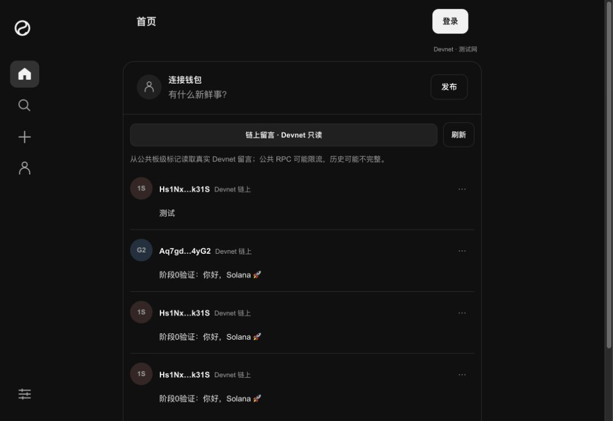

# Said

[English](README.en.md) · [简体中文](README.md) · [Live demo](https://londonyu.github.io/said/)

An open-source guestbook on Solana Devnet. Connect a wallet, sign a short message, and read the public feed or an author's history through RPC. Built with React, TypeScript, and Vite, without a custom application server or traditional database.

This is a learning and portfolio project. The current implementation uses Solana Devnet and is available under the MIT license.



Public-site screenshot from November 1, 2026: real Devnet messages, with no wallet connected.

## Try it

1. Open the [live demo](https://londonyu.github.io/said/). Reading the public feed requires no wallet connection.
2. Connect a wallet to post. Desktop Chrome with Phantom has been verified for real signing; other wallets need separate verification.
3. Make sure the account has a small amount of **Devnet test SOL**. You can request it from the [official Solana faucet](https://faucet.solana.com/), subject to its limits. Devnet SOL and mainnet SOL are separate.
4. Enter a message, preview it, and choose “Prepare post.” Review Devnet, the fee payer, text, and estimated fee, then choose “Sign and send” and confirm in your wallet.
5. Check the confirmation status and Devnet Explorer link. After refreshing, the published message should load from the chain again.

Messages allow up to 140 grapheme clusters and 560 UTF-8 bytes. Text is public. The site does not need a password, private key, or recovery phrase.

If a send result is uncertain, use “Query original signature” or “Query pending records” rather than posting again because of a timeout. Fees depend on the actual estimate and transaction result.

## Run locally

Use Node.js **26.12.1** from [.nvmrc](.nvmrc) and npm **11.20.0** from [package.json](package.json).

```sh
git clone https://github.com/LondonYu/said.git
cd said
npm ci
npm run dev
```

Open <http://127.0.0.1:5173/>. No API key or database setup is required; the app uses the public Solana Devnet RPC. For mobile access, use the live demo. Your computer's `127.0.0.1` is not an address your phone can use.

Existing checks and build commands:

```sh
npm run typecheck
npm test
npm run build
```

The production build is written to `dist/`. GitHub Pages uses the existing manual workflow; ordinary pushes do not deploy automatically. [STATUS](STATUS.md) records the running version and acceptance evidence.

## How it works

- **Identity:** Wallet Standard connects the wallet, and its public key identifies the author. The wallet signs; the site does not hold user keys.
- **Writing:** A v0 transaction sets a compute budget and Devnet priority-fee price, transfers 0 lamports to a fixed board marker, and writes the text through Memo4.
- **Payload:** `{"app":"cyber-guestbook","v":1,"board":"public-devnet-v1","text":"..."}`. The Memo instruction includes the author as a signer. The protocol name remains compatible with existing records.
- **Publishing:** The same message is estimated, simulated, and signed. The client checks returned message bytes and verifies the signature before submitting through the fixed Devnet RPC. Uncertain results are queried by the original signature without automatic re-signing or resending.
- **Reading:** `getSignaturesForAddress` discovers candidates by board marker or author; `getTransaction` validates them. History is paginated rather than scanned across the entire chain, and unavailable records can be retried.
- **Hosting:** GitHub Pages serves the static frontend, which calls RPC directly and uses existing Solana programs. There is no custom on-chain program.

## Adapting it to another chain

There is no multi-chain adapter interface. A port needs to replace and verify these parts for the target chain:

| Module | Responsibility |
| --- | --- |
| [wallet.ts](src/wallet.ts) | Wallet connection, accounts, and signing capabilities |
| [network.ts](src/network.ts) | RPC, network identity, and balances |
| [message.ts](src/message.ts) | Transaction construction, payload, and board-discovery protocol |
| [simulation.ts](src/simulation.ts) | Fee estimation and unsigned simulation |
| [publisher.ts](src/publisher.ts) | Signature verification, submission, confirmation, and receipt recovery |
| [history.ts](src/history.ts) | Candidate discovery, authorship checks, and parsing |

The React interface, themes, language settings, and some text validation can be reused. Changing only the RPC URL is insufficient.

## Verified behavior and limits

The user completed a real Devnet publication in Chrome with Phantom and confirmed that the message remained visible after refreshing. The [verification transaction](https://explorer.solana.com/tx/3gkgb4vK4xypp342nPGwEmJL5gwfhWysWGrcyKQLz1UDPdmeedp5gARgvARYdWyrSsGT5GMGbNV8pMz3iCZvr4nz?cluster=devnet) reached finalized. See [STATUS](STATUS.md) for the evidence.

- Devnet may reset. Public RPC services may throttle requests or lack historical data. Permanent storage and complete availability are not guaranteed.
- Other wallets, mobile signing, and all failure scenarios have not been verified. An initial timeout followed by a successful retry is recorded; its cause is unknown.
- Mainnet posting, sponsored fees, likes, replies, and private messages are outside this implementation.

When reporting an issue, include reproduction steps, wallet and browser versions, error text, and a transaction signature if available. Never include private keys or recovery phrases. See [DECISIONS](DECISIONS.md) and the [archive](docs/sprints/) for decisions and historical work.

## License

[MIT](LICENSE)
