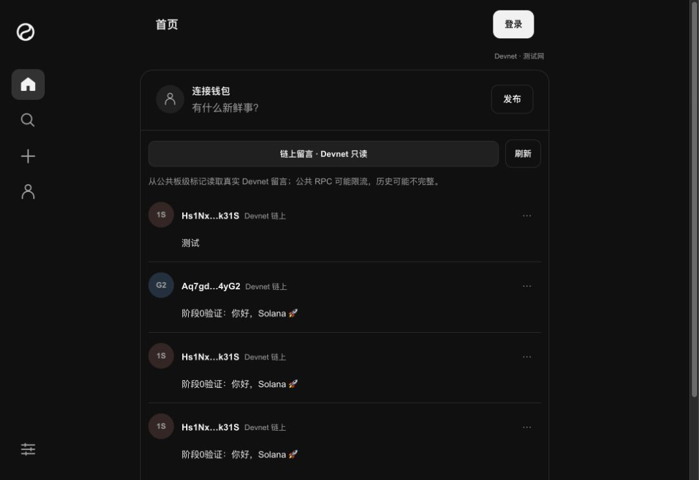

# Said

[简体中文](README.md) · [English](README.en.md) · [在线演示](https://londonyu.github.io/said/)

基于 Solana 的开源链上留言板。连接钱包、签名发布短文字，再通过 RPC 读取公共留言和作者历史。构建时选择 Devnet 或 Solana 主网；Pages 工作流使用主网，本地开发与测试默认 Devnet。React + TypeScript + Vite，无自建业务后端或传统数据库。

这是一个学习与作品集项目，代码按 MIT 协议开放。主网发布使用真实 SOL 支付网络费，平台不额外收费；签名和广播由用户钱包完成。



2026-11-01 公网截图：未连接钱包，从 Devnet 读取真实留言。该截图不代表主网已有记录。

## 快速体验

1. 打开[在线演示](https://londonyu.github.io/said/)，无需连接钱包即可阅读公共留言。Pages 的构建命令固定 `VITE_SOLANA_NETWORK=mainnet`；当前实际部署版本和主网验收状态以 [STATUS](STATUS.md) 为准。
2. 发布时连接钱包。已完成真实签名验证的路径是电脑 Chrome + Phantom 的 Devnet 发布；主网真实签名仍需按 M02/M03 由用户完成并留证。
3. 主网账户需要真实 SOL 支付网络费。页面会显示 Solana 主网、完整付款公钥、原正文和 RPC 实际估费；不承诺固定 5000 lamports，平台不代付或额外收费。
4. 输入留言，预览并点击「准备发布」。核对主网、付款公钥、正文与实际估费后，点击「签名并发送」，由你在钱包确认。
5. 查看确认状态和主网 Explorer 链接。刷新页面后，应能重新读取已上链的主网留言。

正文限制为 140 个可见字符（grapheme clusters）且不超过 560 UTF-8 字节。留言公开；网站不需要密码、私钥或助记词。

如果发送结果待查询，使用「查询原签名」或「查询待确认记录」，不要因超时直接重复发布。实际交易费以当次估费及链上结果为准。

## 本地运行

使用仓库指定的 Node.js **26.12.1**（[.nvmrc](.nvmrc)）和 npm **11.20.0**（[package.json](package.json)）。

```sh
git clone https://github.com/LondonYu/said.git
cd said
npm ci
npm run dev
```

打开 <http://127.0.0.1:5173/>。无需配置 API key 或数据库；未设置 `VITE_SOLANA_NETWORK` 时本地开发连接 Solana Devnet 公共 RPC。手机可直接使用在线演示，电脑的 `127.0.0.1` 不是手机访问地址。

两种构建：

```sh
npm run build                                  # 默认 Devnet
VITE_SOLANA_NETWORK=mainnet npm run build      # Solana 主网
```

已有检查与构建命令：

```sh
npm run typecheck
npm test
```

`VITE_SOLANA_NETWORK` 只接受 `devnet` 或 `mainnet`；非法值会使构建失败。没有运行时 URL/query 切网，也不在 RPC 失败时回退到另一网络。生产构建输出到 `dist/`。GitHub Pages 使用现有手动工作流，普通 push 不会自动部署。当前实例的运行版本与验收记录见 [STATUS](STATUS.md)。

## 技术实现

- **网络配置**：`src/network.ts` 是唯一网络来源，统一提供 chain、RPC、genesis、正文 board、Explorer 和本机回执 key。主网 board 为 `public-mainnet-v1`，Devnet 为 `public-devnet-v1`；两个账本和回执互相隔离，旧 Devnet 记录不迁移。
- **身份**：Wallet Standard 连接钱包，只选择声明支持当前网络账户链的钱包账户，公钥标识作者。签名由钱包完成，网站不持有用户密钥。
- **写入**：v0 交易先设置 400000 CU 上限和 0 micro-lamports/CU 优先费价格，再执行一笔向固定板级标记地址的 0 lamports 转账，最后用 Memo4 写入正文。基础网络费由 RPC 估费。
- **正文协议**：示例为 `{"app":"cyber-guestbook","v":1,"board":"public-mainnet-v1","text":"..."}`；实际 board 由构建网络决定。Memo 指令包含作者签名账户，协议名称保留兼容现有记录。
- **发布校验**：同一消息用于估费、模拟和签名；钱包返回后检查消息字节一致并实际验签，再复核 genesis、会话、区块高度、费用和余额，通过后只广播一次。未知结果按原签名查询，不自动重签或重发。
- **钱包兼容**：Phantom 在 Solana 主网自动新增的 Lighthouse 防钓鱼守卫按精确白名单处理。原有 ComputeBudget、System 零转账、Memo、账户引用和 blockhash 必须保持一致，只允许额外加入审计过的 Lighthouse 程序指令；其他修改继续拒绝，并按钱包实际签名消息重新估费。
- **读取**：按板级标记或作者地址调用 `getSignaturesForAddress`，再用 `getTransaction` 校验候选和 board。分页读取，不扫描整个区块链；不可得记录保留重试入口。
- **部署**：静态网页托管于 GitHub Pages，前端直连 RPC；使用已有 Solana 程序，无自定义链上程序。

## 网络选择时需要核对什么

| 模块 | 职责 |
| --- | --- |
| [wallet.ts](src/wallet.ts) | 钱包连接、当前网络账户与签名能力 |
| [network.ts](src/network.ts) | 构建时网络选择、RPC、genesis 和余额 |
| [message.ts](src/message.ts) | 交易构造、正文与按网络选择的 board |
| [simulation.ts](src/simulation.ts) | 当前网络估费和未签名模拟 |
| [publisher.ts](src/publisher.ts) | 签名验证、提交、确认与按网络隔离的回执恢复 |
| [history.ts](src/history.ts) | 当前网络候选发现、作者身份校验和 board 解析 |

React 界面、主题、语言设置和部分正文校验可以复用；只更换 RPC 地址不能完成网络切换。

## 已验证与限制

用户已在 Chrome + Phantom 完成真实 Devnet 与 Solana 主网签名发布，并确认刷新后可读。[主网验证交易](https://explorer.solana.com/tx/1BuLMQJnNreHBv1JtsLeqB1SUkCTEeMHAs6BgknUG72UQLAYyNmCXf3F1BN5qax2X638RnbK5xFhNVMVHbcf3Qp)达到 finalized，正文“测试”在部署后公网页面可读回；完整证据见 [STATUS](STATUS.md)。

- 主网版本已部署到 GitHub Pages；公网页面、Phantom 主网连接、真实签名、广播、finalized确认和刷新读回均已完成。
- 主网首条留言为正文“测试”，作者由付款签名推导，费用为5000 lamports。旧 Devnet 留言仍在 Devnet，不称为迁移或删除。
- 主网使用 `https://rpc.solanatracker.io/public` 与 Phantom Lighthouse 守卫最小白名单；核心交易指令和账户必须保持不变，其他钱包修改继续拒绝。
- 公共 RPC 可能限流或缺少历史，不承诺永久存储或始终完整可读。主网基础费以当次 RPC 估费为准。
- 全钱包、手机签名和全部异常场景尚未验证。首次超时、重试成功的 Devnet 反馈已记录，根因未知。
- 功能不含代付、平台收费、点赞、回复或私信。

反馈问题时提供复现步骤、钱包和浏览器版本、错误文本，以及交易签名（如有）。不要提供私钥或助记词。决策与被否方案见 [DECISIONS](DECISIONS.md)，历史工单和证据见 [归档](docs/sprints/)。

## License

[MIT](LICENSE)
